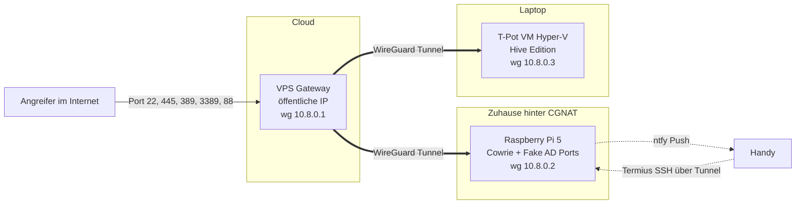

# Raspberry Pi Honeypot hinter CGNAT

SSH Honeypot auf einem Raspberry Pi 5 mit Cowrie, vorgetäuschten Active Directory Diensten und T‑Pot als zweitem Sensor. Weil der Heimanschluss hinter CGNAT liegt, kommt der Angriffsverkehr über einen kleinen Cloud‑VPS mit öffentlicher IP und wird per WireGuard zum Pi und zur T‑Pot VM weitergereicht. Logins lösen eine Push‑Nachricht am Handy aus, die Auswertung läuft über ein selbst gebautes HTML‑Dashboard.

Schulprojekt im Rahmen der Ausbildung zum Netzwerktechniker am Schulungszentrum Fohnsdorf.

## Ziel

Echte Angriffe aus dem Internet sichtbar machen, ohne das eigene Heimnetz zu gefährden, und das Ganze so dokumentieren und präsentieren, dass es auch Leute ohne IT‑Hintergrund verstehen. Rahmen waren rund zwei Wochen Zeit und ein kleines Budget.

## Architektur



Genauer erklärt in [docs/architektur.md](docs/architektur.md).

## Komponenten

| Komponente | Aufgabe | Technik |
|---|---|---|
| VPS Gateway | Öffentliche IP, nimmt Angriffe an und leitet sie weiter | Debian, WireGuard, iptables DNAT |
| Raspberry Pi 5 (8 GB) | Haupt‑Sensor, fake SSH Shell und fake AD Dienste | Raspberry Pi OS, Docker, Cowrie, portfake.py |
| T‑Pot VM | Zweiter Sensor mit vielen Honeypots und Kibana | Hyper‑V Gen 1, Debian, T‑Pot Hive |
| Handy | Alarm und Fernzugriff | ntfy App, Termius |
| Auswertung | Statistiken und Dashboard | Python, jq |

## Funktionen

| Funktion | Beschreibung |
|---|---|
| Fake SSH Server | Cowrie nimmt Logins an, simuliert eine Linux Shell und protokolliert jeden Befehl |
| Fake Active Directory | SMB, LDAP, Kerberos, RPC und RDP Ports antworten mit Windows‑typischen Bannern |
| Echte Angreifer‑IPs | Kein Masquerading am Gateway, die Logs zeigen die echte Quell‑IP |
| Push‑Alarm | Bei jedem erfolgreichen Login kommt eine Nachricht mit IP, Benutzer und Passwort aufs Handy |
| LAN‑Sperre | Der Pi darf aus dem Honeypot heraus nicht ins Heimnetz |
| Dashboard | cowrie_auswertung.py erstellt eine HTML‑Seite mit Top‑Passwörtern, Ländern, Befehlen und Downloads |
| Zweiter Sensor | T‑Pot liefert zusätzliche Honeypots und Kibana‑Auswertungen |

## Schnellstart

Die komplette Anleitung steht in den einzelnen Kapiteln. Kurzfassung der Reihenfolge:

| Schritt | Kapitel |
|---|---|
| VPS mieten, absichern, WireGuard und Weiterleitung einrichten | [docs/vps-gateway.md](docs/vps-gateway.md) |
| Pi vorbereiten, WireGuard Client, Rückroute | [docs/raspberry-pi.md](docs/raspberry-pi.md) |
| Cowrie in Docker starten | [docs/cowrie.md](docs/cowrie.md) |
| Fake AD Ports aktivieren | [docs/ad-ports.md](docs/ad-ports.md) |
| T‑Pot VM als zweiten Sensor anbinden | [docs/tpot.md](docs/tpot.md) |
| Push‑Alarm, Termius, LAN‑Sperre | [docs/monitoring.md](docs/monitoring.md) |
| Logs auswerten und Dashboard bauen | [docs/auswertung.md](docs/auswertung.md) |
| Sicherheitsmaßnahmen | [docs/sicherheit.md](docs/sicherheit.md) |
| Fehlersuche | [docs/troubleshooting.md](docs/troubleshooting.md) |
| Ergebnisse und beobachtete Angriffe | [docs/erkenntnisse.md](docs/erkenntnisse.md) |

## Repo‑Struktur

```text
raspi-honeypot/
├── README.md
├── LICENSE
├── .gitignore
├── docs/                    Ausführliche Doku
├── config/
│   ├── vps/                 WireGuard und iptables für das Gateway
│   ├── pi/                  WireGuard Client mit Rückroute
│   ├── tpot/                WireGuard Client für die T-Pot VM
│   ├── cowrie/              docker-compose, cowrie.cfg, userdb
│   └── systemd/             Dienste für Alarm, LAN-Sperre, portfake
├── scripts/
│   ├── cowrie_auswertung.py HTML-Dashboard
│   ├── portfake.py          Fake AD Ports
│   ├── hp-alarm.sh          Push-Benachrichtigung
│   └── lansperre.sh         Sperre ins Heimnetz
└── screenshots/             Bilder für die Präsentation
```

## Platzhalter

Alle Konfigurationsdateien enthalten Platzhalter statt echter Werte. Vor dem Einsatz ersetzen:

| Platzhalter | Bedeutung |
|---|---|
| `<VPS_IP>` | Öffentliche IP des Gateways |
| `<ADMIN_SSH_PORT>` | Echter SSH Port für die Verwaltung (nicht 22) |
| `<ADMIN_USER>` | Eigener Benutzername am Pi bzw. VPS |
| `<NTFY_TOPIC>` | Geheimer ntfy Kanalname |
| `<HEIMNETZ>` | Eigenes LAN, zum Beispiel 192.168.1.0/24 |
| `<..._PRIVATE_KEY>` / `<..._PUBLIC_KEY>` | WireGuard Schlüssel |

Echte Schlüssel, IPs und Logs gehören nicht ins Repo, die `.gitignore` schließt sie aus.

## Rechtlicher Hinweis

Ein Honeypot zeichnet Daten von fremden Systemen auf, darunter IP‑Adressen. Das Projekt dient ausschließlich Lern‑ und Forschungszwecken. Gesammelte Daten werden nicht veröffentlicht, Malware‑Proben werden nicht ausgeführt. Bei Vorführungen mit Mitschülern wird vorher angekündigt, dass alle Eingaben protokolliert werden.

## Lizenz

MIT, siehe [LICENSE](LICENSE).
