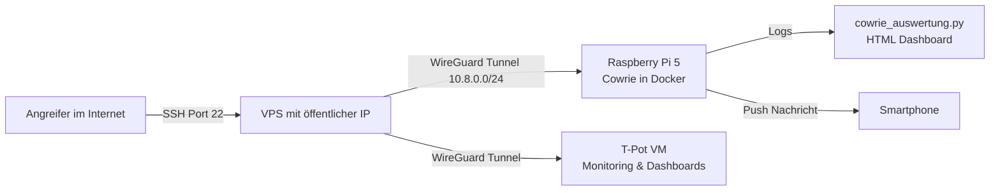

# 🍯 Raspberry Pi 5 SSH Honeypot mit Cowrie


Ein echter Honeypot im Internet, der Angreifer anlockt, jeden ihrer Schritte aufzeichnet und daraus verständliche Auswertungen erstellt. Entstanden als Ausbildungsprojekt im Bereich IT Netzwerktechnik am Schulungszentrum Fohnsdorf.

## Worum geht es?

Ein Honeypot ist ein absichtlich verwundbar wirkendes System. Es sieht für Angreifer aus wie ein normaler Linux Server mit offenem SSH Zugang, ist aber in Wahrheit eine kontrollierte Falle. Jeder Loginversuch, jedes eingegebene Passwort und jeder ausgeführte Befehl wird protokolliert, ohne dass der Angreifer echten Schaden anrichten kann.

Ziel des Projekts war es, mit wenig Budget und in rund zwei Wochen einen dauerhaft erreichbaren Honeypot aufzubauen, die Angriffe live zu überwachen und die Ergebnisse so aufzubereiten, dass sie auch Menschen ohne IT Hintergrund verstehen.

## Architektur



| Komponente | Rolle | Netz |
|:--|:--|:--|
| VPS (Hetzner) | Öffentlicher Eingang, leitet Angriffsverkehr in den Tunnel weiter | öffentliche IP + 10.8.0.1 |
| Raspberry Pi 5 (8 GB) | Honeypot Sensor mit Cowrie, simuliert zusätzlich typische Active Directory Ports | 10.8.0.2 |
| T-Pot VM | Zentrales Monitoring, Visualisierung der Angriffe | 10.8.0.3 |
| Smartphone | Fernwartung per SSH und Benachrichtigung bei Logins | über WireGuard |

## Warum ein VPS statt Portfreigabe?

Der Heimanschluss läuft über 5G mit CGNAT. Dabei teilen sich viele Kunden eine öffentliche IP, eingehende Verbindungen kommen also nie beim eigenen Router an und eine klassische Portfreigabe ist unmöglich.

Die Lösung ist ein günstiger VPS mit eigener öffentlicher IP. Der Raspberry Pi baut von sich aus einen WireGuard Tunnel zum VPS auf. Da die Verbindung von innen nach außen aufgebaut wird, funktioniert sie trotz CGNAT. Der VPS nimmt die Angriffe entgegen und schickt sie durch den Tunnel an den Pi weiter.

Nebeneffekt: Das Heimnetz bleibt vollständig verborgen. Angreifer sehen nur die IP des VPS, niemals die echte Adresse des Standorts. Der Pi steht außerdem rund 70 km entfernt und ist trotzdem jederzeit über den Tunnel erreichbar.

## Installation

### Cowrie auf dem Raspberry Pi

Cowrie läuft als Docker Container. Dadurch ist der Honeypot vom eigentlichen Betriebssystem getrennt und lässt sich jederzeit neu aufsetzen.

```bash
sudo apt update && sudo apt install -y docker.io
sudo docker run -d \
  --name cowrie \
  --restart unless-stopped \
  -p 2222:2222 \
  -v cowrie-var:/cowrie/cowrie-git/var \
  cowrie/cowrie:latest
```

Cowrie lauscht intern auf Port 2222. Der echte SSH Dienst des Pi läuft auf einem anderen, nicht standardmäßigen Port und erlaubt ausschließlich Schlüssel Login.

### WireGuard Tunnel

Auf dem VPS und auf dem Pi wird WireGuard installiert. Der Pi verbindet sich als Client mit dem VPS.

```bash
sudo apt install -y wireguard
wg genkey | tee privatekey | wg pubkey > publickey
```

Beispiel für die Client Konfiguration am Pi (`/etc/wireguard/wg0.conf`):

```ini
[Interface]
Address = 10.8.0.2/24
PrivateKey = <PRIVATER_SCHLÜSSEL_PI>

[Peer]
PublicKey = <ÖFFENTLICHER_SCHLÜSSEL_VPS>
Endpoint = <VPS_IP>:51820
AllowedIPs = 10.8.0.0/24
PersistentKeepalive = 25
```

```bash
sudo systemctl enable --now wg-quick@wg0
```

`PersistentKeepalive` hält die Verbindung durch das CGNAT offen.

### Weiterleitung am VPS

Der VPS leitet eingehenden SSH Verkehr auf Port 22 durch den Tunnel an Cowrie weiter. Die echte Verwaltung des VPS läuft auf einem eigenen Port.

```bash
sudo sysctl -w net.ipv4.ip_forward=1
sudo iptables -t nat -A PREROUTING -i eth0 -p tcp --dport 22 -j DNAT --to-destination 10.8.0.2:2222
sudo iptables -t nat -A POSTROUTING -o wg0 -j MASQUERADE
```

Wichtig: Vorher den Verwaltungs SSH des VPS auf einen anderen Port verlegen, sonst sperrt man sich selbst aus.

## Monitoring

### T-Pot

T-Pot von der Deutschen Telekom läuft als virtuelle Maschine und ist über WireGuard angebunden. Es liefert fertige Dashboards mit Weltkarte, Angriffsstatistiken und Zeitverläufen und eignet sich besonders gut für die Präsentation.

### Eigenes Auswertungsskript

`cowrie_auswertung.py` liest die JSON Logs von Cowrie ein und erzeugt daraus ein eigenständiges HTML Dashboard, das sich in jedem Browser öffnen lässt.

```bash
python3 cowrie_auswertung.py
```

Das Dashboard zeigt unter anderem

| Auswertung | Aussage |
|:--|:--|
| Häufigste Benutzernamen | Welche Accounts Angreifer zuerst probieren (root, admin, pi, ubuntu …) |
| Häufigste Passwörter | Wie schwach die Passwortlisten der Bots sind |
| Herkunft der IPs | Aus welchen Ländern die Angriffe kommen |
| Ausgeführte Befehle | Was Angreifer nach dem Login tatsächlich vorhaben |
| Zeitverlauf | Wie schnell ein neuer Server im Internet gefunden wird |

### Benachrichtigung aufs Handy

Sobald sich jemand erfolgreich am Honeypot einloggt, kommt eine Push Nachricht mit der Angreifer IP aufs Smartphone. Die Fernwartung erfolgt über die App Termius per SSH durch den WireGuard Tunnel.

## Sicherheitskonzept

| Maßnahme | Zweck |
|:--|:--|
| Cowrie in Docker | Angreifer landen in einer simulierten Shell, nicht im echten System |
| VPS als Vorposten | Heimnetz und echte Standort IP bleiben unsichtbar |
| Nur Schlüssel Login am Pi | Kein Passwort Angriff auf den echten Zugang möglich |
| Nicht standardmäßige Verwaltungsports | Trennung von Honeypot Verkehr und Administration |
| Eigenes WireGuard Netz | Verwaltung ausschließlich über den verschlüsselten Tunnel |

## Erkenntnisse

Ein frisch erreichbarer SSH Port wird innerhalb kürzester Zeit von automatisierten Bots gefunden. Die allermeisten Angriffe sind keine gezielten Hacker, sondern Skripte, die rund um die Uhr Standardpasswörter durchprobieren. Nach einem erfolgreichen Login versuchen viele Bots sofort, Schadsoftware nachzuladen, Kryptominer zu starten oder den Server in ein Botnetz einzubinden.

Die wichtigste Lehre für die Praxis: Standardpasswörter und Passwort Logins über das Internet sind ein enormes Risiko. Schlüssel Authentifizierung, geänderte Ports und Fail2ban schützen echte Server bereits gegen den Großteil dieser Angriffe.

## Verwendete Technik

Raspberry Pi 5 mit 8 GB RAM, Raspberry Pi OS, Docker, Cowrie, WireGuard, Hetzner VPS, iptables, T-Pot, Python 3, Termius

## Rechtlicher Hinweis

Dieses Projekt dient ausschließlich Ausbildungs und Forschungszwecken. Der Honeypot greift selbst niemanden an, sondern zeichnet nur eingehende Verbindungen auf. Zugangsdaten, echte IP Adressen und private Schlüssel sind in diesem Repository bewusst nicht enthalten.

## Autor

**Tscheky0**
IT Netzwerktechnik Ausbildung am Schulungszentrum Fohnsdorf, Steiermark
