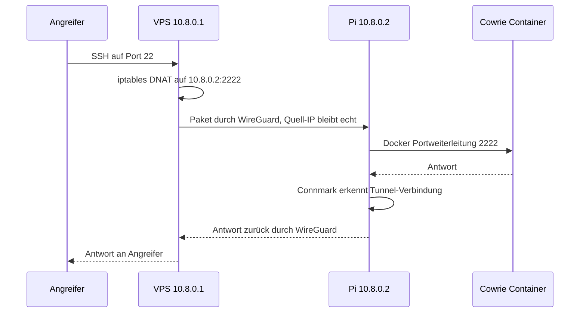

# Architektur

## Das Problem: CGNAT

Der Heimanschluss läuft über Magenta 5G Fixed Wireless. Der Router bekommt dabei keine eigene öffentliche IPv4, sondern teilt sich eine Adresse mit vielen anderen Kunden (Carrier Grade NAT). Eine klassische Portfreigabe am Router bringt deshalb nichts, Verbindungen aus dem Internet kommen nie bei uns an.

## Die Lösung: Gateway in der Cloud

Ein kleiner gemieteter VPS hat eine eigene öffentliche IP. Er dient als Eingangstür. Der Pi baut von sich aus einen WireGuard Tunnel zum VPS auf, ausgehende Verbindungen funktionieren auch hinter CGNAT. Über diesen Tunnel schiebt der VPS die Angriffe weiter.

Vorteile gegenüber einer Portfreigabe zu Hause:

| Punkt | Portfreigabe | VPS mit Tunnel |
|---|---|---|
| Funktioniert hinter CGNAT | nein | ja |
| Heim‑IP sichtbar für Angreifer | ja | nein |
| Heimrouter muss angefasst werden | ja | nein |
| Standort des Pi egal | nein | ja, der Pi steht ca. 70 km entfernt |
| Kosten | keine | wenige Euro im Monat |

## Adressplan

| Gerät | WireGuard IP | Rolle |
|---|---|---|
| VPS Gateway | 10.8.0.1 | Server, öffentliche IP, Weiterleitung |
| Raspberry Pi 5 | 10.8.0.2 | Cowrie und Fake AD Ports |
| T‑Pot VM | 10.8.0.3 | Zweiter Sensor |
| Admin Laptop (optional) | 10.8.0.5 | Fernwartung |

Netz: `10.8.0.0/24`, WireGuard Port am VPS: `51820/udp`.

## Portplan

| Öffentlicher Port am VPS | Ziel | Dienst |
|---|---|---|
| 22/tcp | 10.8.0.2:2222 | Cowrie SSH |
| 23/tcp | 10.8.0.2:2223 | Cowrie Telnet (optional) |
| 88/tcp | 10.8.0.2:88 | Fake Kerberos |
| 135/tcp | 10.8.0.2:135 | Fake RPC |
| 389/tcp | 10.8.0.2:389 | Fake LDAP |
| 445/tcp | 10.8.0.2:445 | Fake SMB |
| 3389/tcp | 10.8.0.2:3389 | Fake RDP |
| frei wählbare Ports | 10.8.0.3 | T‑Pot Honeypots |
| `<ADMIN_SSH_PORT>`/tcp | VPS selbst | Echte Verwaltung |
| 51820/udp | VPS selbst | WireGuard |

Verwaltungszugänge (echtes SSH am Pi, T‑Pot SSH auf 64295, Kibana auf 64297) sind nur innerhalb des Tunnels erreichbar.

## Weg eines Angriffs

## Warum kein Masquerading

Würde der VPS die Pakete maskieren, sähe Cowrie als Absender immer nur 10.8.0.1. Die ganze Auswertung nach Ländern und Angreifern wäre wertlos. Deshalb bleibt die echte Quell‑IP erhalten. Dafür muss der Pi aber wissen, dass Antworten auf solche Verbindungen zurück in den Tunnel gehören und nicht über das Heimnetz ins Internet. Das löst die Rückroute mit Connection Marking, beschrieben in [raspberry-pi.md](raspberry-pi.md).

## Rollen der Sensoren

Der Pi ist bewusst schlank gehalten: nur Cowrie und ein kleines Python Skript für die AD Ports. T‑Pot ist deutlich schwerer (viel RAM, viele Container) und läuft deshalb als VM am Laptop. So bleibt der Pi stabil und T‑Pot liefert trotzdem Kibana‑Dashboards und weitere Honeypot‑Typen.
